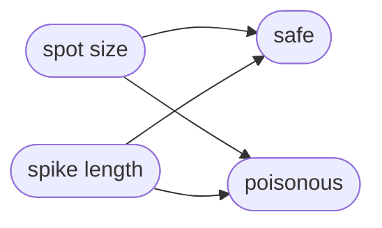
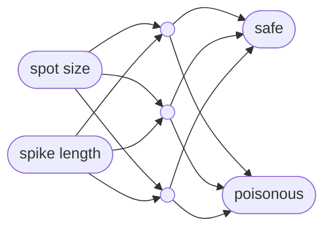
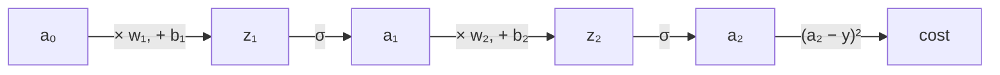
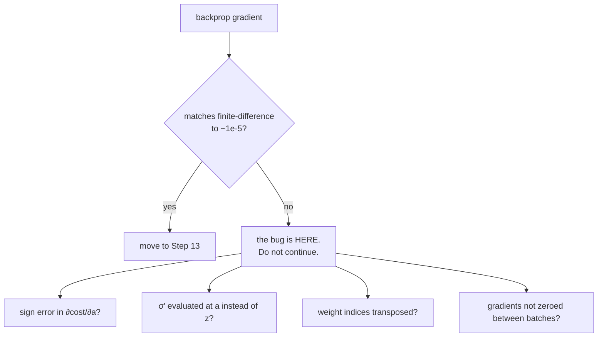
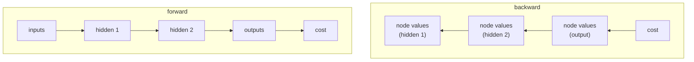

# Neural Network From Scratch — Learning Plan

Working through [Sebastian Lague's "How to Create a Neural Network (and Train it to Identify Doodles)"](https://www.youtube.com/watch?v=hfMk-kjRv4c), building everything by hand.

**Stack:** Python 3 + NumPy. No ML frameworks — the point is understanding, not results.

## Division of labour

| | Owner |
|---|---|
| All network code (`nn/`) | me |
| All notes and derivations (`notes/`) | me |
| Visualization and animation (`viz/`) | Claude |

## Layout

```
NN/
├── PLAN.md      ← this file
├── nn/          ← my implementation
├── viz/         ← Claude's animations, imports from nn/, never modifies it
├── notes/       ← my derivations and findings per step
└── data/        ← datasets (gitignored)
```

The separation matters: `viz/` only ever *reads* from `nn/`. If an animation needs something the network doesn't expose, that's a signal the network's interface is missing something — not a licence to tangle the two.

## The one rule

**Each step is designed to fail in a way that motivates the next one.** Do not skip ahead to backpropagation. The lesson in Part 2 is *feeling* how slow the naive version is; that feeling is what makes Part 3 worth the calculus.

---

## Roadmap

```mermaid
flowchart TD
    subgraph P1["Part 1 · Toy problem, no learning"]
        direction TB
        S1["1 · Fake fruit data"]
        S2["2 · Weights only"]
        S3["3 · Biases"]
        S4["4 · Hidden layers"]
        S5["5 · Activation functions"]
        S1 --> S2
        S2 -->|"boundary only rotates about the origin"| S3
        S3 -->|"a straight line cannot cut out the blob"| S4
        S4 -->|"still a straight line — linear ∘ linear = linear"| S5
    end

    subgraph P2["Part 2 · Learning, the slow way"]
        direction TB
        S6["6 · Cost function"]
        S7["7 · Gradient descent in 1-D"]
        S8["8 · Finite-difference gradients"]
        S9["9 · Mini-batches"]
        S6 -->|"counting correct answers is a step function — no signal"| S7
        S7 --> S8
        S8 -->|"one step costs params × datapoints forward passes"| S9
        S9 -->|"faster, but still O#40;params#41; per step"| DONE2[" "]
    end

    subgraph P3["Part 3 · Backpropagation"]
        direction TB
        S10["10 · Derivatives by hand"]
        S11["11 · Cache the forward pass"]
        S12["12 · Output-layer node values"]
        S13["13 · Hidden-layer node values"]
        S10 --> S11 --> S12 --> S13
    end

    subgraph P4["Part 4 · Real data"]
        direction TB
        S14["14 · MNIST digits"]
        S15["15 · ReLU, cross-entropy, momentum"]
        S16["16 · Draw your own digit"]
        S17["17 · Augmentation + input noise"]
        S18["18 · Fashion-MNIST"]
        S19["19 · Quick Draw doodles"]
        S20["20 · CIFAR-10, the wall"]
        S14 --> S15 --> S16
        S16 -->|"98% on test set, hopeless on my handwriting"| S17
        S17 --> S18 --> S19 --> S20
    end

    S5 --> S6
    DONE2 --> S10
    S13 --> S14
    S20 -->|"no spatial awareness, no translation invariance"| CNN["→ convolutional networks"]

    style DONE2 fill:none,stroke:none
    style CNN stroke-dasharray: 5 5
```



---

# Part 1 — The toy problem (no learning yet)

### Step 1 · Fake fruit data

Generator for the 2-input toy problem: `spot_size`, `spike_length` → label `safe` / `poisonous`. Build **two** datasets:

- `linear` — separable by a straight line
- `blob` — poisonous class sits in a patch in the middle, needs a curved boundary

**Checkpoint:** scatter plot shows the two shapes I intended.
**Claude animates:** the scatter plot for both datasets.

### Step 2 · A single layer, weights only

`Layer` holding a weight matrix. `calculate_outputs(inputs)` = weighted sums. No bias, no activation. A `Network` wrapping one layer, plus `classify()` returning the argmax of the two outputs. Weights hardcoded by hand.



Two outputs rather than one signed value, because later problems have 10 classes and the interface should already be general.

**Checkpoint:** hand-tuning the weights rotates the boundary — and it always passes through the origin.
**Claude animates:** decision-boundary viewer with a live slider per weight. Reused for steps 3–5.

### Step 3 · Biases

Add a bias vector, added to the weighted sums.

**Checkpoint:** I can hand-train this to separate `linear` perfectly. Then try `blob` and confirm it is impossible.

### Step 4 · Hidden layers

Generalize `Network` to take a layer-size list, e.g. `[2, 3, 2]`, feeding outputs forward through every layer.



12 weights, 5 biases. Note the convention: this middle layer has **2 incoming, 3 outgoing**. The input "layer" is not a layer in code — it does nothing but hold values.

**Checkpoint:** the boundary is *still* a straight line however I tune it. Write down why: composing linear maps gives a linear map. That is the entire reason activation functions exist.

### Step 5 · Activation functions

Add a step activation, then sigmoid. Applied per layer to the weighted inputs.

**Checkpoint:** with sigmoid and one hidden layer I can hand-tune a curved boundary that solves `blob`. Also note that under the step function a tiny slider nudge flips the output violently, and under sigmoid it doesn't — that smoothness is what makes gradients possible.
**Claude animates:** step / sigmoid / ReLU / tanh graphs side by side; boundary viewer updated to show smooth confidence rather than a hard two-colour split.

---

# Part 2 — Learning, the slow way

### Step 6 · Cost

```
node_cost(output, expected) = (output - expected)²
cost(datapoint)             = Σ over output nodes
cost(dataset)               = mean over datapoints
```

Squared so it is positive, and so large errors are weighted as more urgent than small ones.

**Checkpoint:** hand-tune and watch cost fall as the boundary improves. Also implement "number classified correctly" and observe that it is a *step* function — small weight changes don't move it at all. That is precisely why cost exists.

### Step 7 · Gradient descent in 1-D

Set the network aside entirely. Take `f(x) = x² - 3x + 4`, or something wigglier with several minima.

```
slope = (f(x + h) - f(x)) / h      # h tiny
x    -= slope * learn_rate         # repeat
```

**Checkpoint:** run it with a learn rate that is too small (crawls), too large (bounces around, never settles), and about right. Find a starting point that falls into a local minimum rather than the global one.
**Claude animates:** the ball rolling down the curve with the tangent line drawn each step, and a learn-rate slider so I can watch it diverge.

### Step 8 · Finite-difference gradients on the real network

For every weight and bias: nudge by `h`, recompute the **whole dataset cost**, store `Δcost / h` in a gradient array, restore the parameter. Then `apply_gradients(learn_rate)` subtracts the gradient from each parameter.

**Checkpoint:** it learns the fruit dataset unaided. Then time one iteration and count the forward passes:

```
(num_params + 1) × num_datapoints
```

Write that number down. Step 13 is going to demolish it.
**Claude animates:** cost-over-time curve alongside the decision boundary morphing live during training. First "it's alive" moment.

### Step 9 · Mini-batches

Shuffle, split into batches, one gradient step per batch; one pass over all batches = an epoch.

**Checkpoint:** much faster wall-clock progress, visibly noisier cost curve. Understand that the noise is each batch disagreeing about which way is downhill — and that the noise can *help*, by shaking the network out of saddle points.
**Claude animates:** full-batch vs mini-batch cost curves on shared axes.

---

# Part 3 — Backpropagation

### Step 10 · Derivatives by hand

Paper only. No code until all three are done:

1. `d/dx (x² - 3x + 4)` from the limit definition — expand, cancel, let `h → 0`. Answer: `2x - 3`.
2. `∂cost/∂a` where `cost = (a - y)²` → `2(a - y)`.
3. `σ'(z) = σ(z)(1 - σ(z))`.

Then take the minimal chain and write `∂cost/∂w₂` as a product of partials:



`∂cost/∂w₂ = ∂z₂/∂w₂ · ∂a₂/∂z₂ · ∂cost/∂a₂`

The four partials that are all you ever need:

| partial | value | why |
|---|---|---|
| `∂z/∂w` | `a` (the incoming activation) | if the input is 0, changing the weight does nothing |
| `∂z/∂b` | `1` | nothing scales the bias |
| `∂z/∂a_prev` | `w` | the weight determines how much the input matters |
| `∂a/∂z` | `σ'(z)` | the activation function's own slope |

Now write `∂cost/∂w₁` the same way.

**Checkpoint:** I can state in one sentence why `∂cost/∂w₁` reuses almost all the work from `∂cost/∂w₂`. That reuse *is* backpropagation — everything else is bookkeeping.
**Claude animates:** `f(x)` and `f'(x)` on shared axes, so zero-slope points line up visually with the zeros of the derivative.

### Step 11 · Caching the forward pass

Each layer stores its `inputs`, `weighted_inputs` (z) and `activations` as it computes them. Backprop needs all three.

**Checkpoint:** identical predictions to before. Nothing else changed.

### Step 12 · Output-layer node values

```
node_value[i]      = ∂cost/∂a[i] × σ'(z[i])
weight_grad[i][j] += input[j] × node_value[i]
bias_grad[i]      += node_value[i]
```

**Checkpoint — the critical one.** On a tiny network, compare every backprop gradient against the Step 8 finite-difference gradient:



A wrong gradient still "trains" — just badly, and silently. This check is the only thing standing between me and days of confusion in Part 4.

### Step 13 · Hidden-layer node values

```
new_node_value[j] = ( Σᵢ w[i][j] × old_node_value[i] ) × σ'(z[j])
```

Then loop backwards from the output layer so it works for any depth.



Once per datapoint forward, once backward — versus once per *parameter* in Step 8.

**Checkpoint:** gradient-check again on a deeper net, e.g. `[3, 4, 4, 2]`. Then train the fruit dataset and confirm the same result as Step 8, dramatically faster. Compare against the forward-pass count written down in Step 8.
**Claude animates:** signal flowing forward then error flowing backward through the network graph, edge thickness showing gradient magnitude. The picture that makes backprop click.

---

# Part 4 — Real data

### Step 14 · MNIST digits

70,000 images, 28×28 = 784 inputs, normalized to 0–1, labels one-hot encoded. **Hold back a test set and never train on it.**

Start with `[784, 10]` — no hidden layer, expect it to plateau near 90%. Then `[784, 100, 10]`.

Worth sitting with: each image is a point in 784-dimensional space, and the network is carving that space into 10 regions. Exactly what it did with the 2-D fruit, just in more dimensions than anyone can picture.

**Checkpoint:** ~95% test accuracy. Build a "show me the ones it got wrong" browser — the mistakes teach far more than the successes.
**Claude animates:** image grid with predictions and confidence bars; confusion matrix; first-layer weights rendered as 28×28 images.

### Step 15 · Make it actually good

Add these **one at a time**, measuring after each, and re-tuning the learn rate after each:

- ReLU in the hidden layers
- cross-entropy cost with a softmax output layer
- momentum in gradient descent

Re-tuning matters: in the video momentum appeared to make things *worse*, and the real cause was that the effective learn rate had become too high.

**Checkpoint:** ~97–98% test accuracy, and a table in `notes/` recording what each change bought.
**Claude animates:** accuracy curves per variant on shared axes.

### Step 16 · Draw your own digit

Interactive canvas → downsample to 28×28 → live prediction.

**Checkpoint:** it will be *terrible* on my handwriting despite 98% test accuracy. Sit with that — it is the most important lesson in the project. MNIST digits are size-normalized and centred; mine are not. The test set was never as independent as it looked.
**Claude animates:** the canvas itself, with a live confidence ranking of all ten digits.

### Step 17 · Augmentation and input noise

Randomly rotate / scale / translate / add noise to the training images. Retrain with a larger network, since the task just got harder. Then add random noise to the network's inputs during training too.

**Checkpoint:** accuracy on the clean test set *drops*, but my own handwriting finally works. Record the gap between train accuracy (~99%) and test accuracy — that gap is overfitting, and both augmentation and input noise are attacks on it.

### Step 18 · Fashion-MNIST

Pure drop-in: identical data shape, change only the loader. Free proof that nothing in the code is secretly digit-specific.

**Checkpoint:** ~89%, having changed nothing but a file path. (Human performance is around 83%.)

### Step 19 · Quick Draw doodles

10 categories from the [Quick, Draw!](https://quickdraw.withgoogle.com/data) dataset. Same pipeline, same augmentation, more hidden layers.

**Checkpoint:** ~87%. Print **per-category** accuracy — the aggregate number hides that some classes are far worse than others.
**Claude animates:** doodle canvas with live top-10 predictions, plus a per-category accuracy bar chart.

### Step 20 · CIFAR-10, the wall

32×32 colour → 3072 inputs. The object is not cut out of its background; scale, pose and lighting vary wildly.

**Checkpoint:** ~50%, and I can explain *why* a fully-connected network is the wrong tool — it has no notion that neighbouring pixels are related, and no translation invariance, so a cat in the corner and a cat in the centre share nothing. That explanation is the entry ticket to convolutional networks.

---

## Progress

- [x] 1 · Fake fruit data
- [x] 2 · Weights only
- [x] 3 · Biases
- [x] 4 · Hidden layers
- [x] 5 · Activation functions
- [x] 6 · Cost function
- [ ] 7 · Gradient descent in 1-D
- [ ] 8 · Finite-difference gradients
- [ ] 9 · Mini-batches
- [ ] 10 · Derivatives by hand
- [ ] 11 · Cache the forward pass
- [ ] 12 · Output-layer node values **← gradient check**
- [ ] 13 · Hidden-layer node values **← gradient check**
- [ ] 14 · MNIST digits
- [ ] 15 · ReLU, cross-entropy, momentum
- [ ] 16 · Draw your own digit
- [ ] 17 · Augmentation + input noise
- [ ] 18 · Fashion-MNIST
- [ ] 19 · Quick Draw doodles
- [ ] 20 · CIFAR-10
