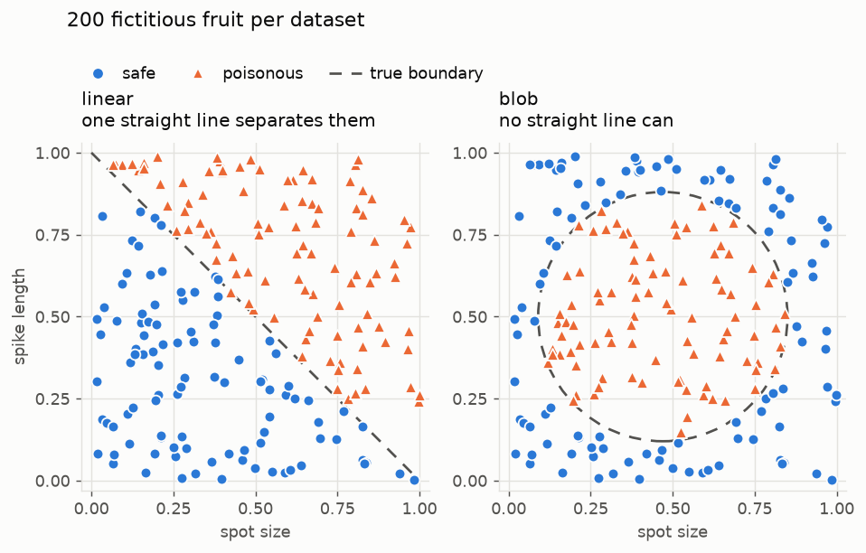
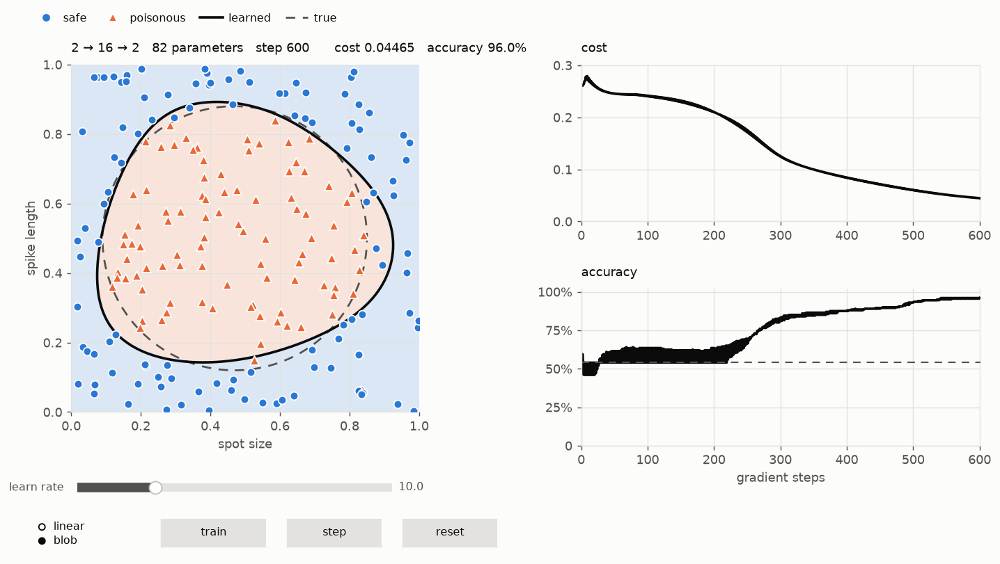

# Neural network from scratch

Building a neural network by hand in Python and NumPy — no ML frameworks —
following [Sebastian Lague's video](https://www.youtube.com/watch?v=hfMk-kjRv4c).

**[PLAN.md](PLAN.md)** is the roadmap: 20 steps, from a 2-input toy problem to
CIFAR-10, with the checkpoint for each.



## Layout

```
nn/     the implementation      (data.py, network.py, descent.py)
viz/    plots and animations    (reads from nn/, never modifies it)
notes/  derivations per step
data/   datasets (gitignored)
```

## Running it

```bash
python3 -m venv .venv && .venv/bin/pip install -r requirements.txt

.venv/bin/python nn/data.py                       # dataset sanity check
.venv/bin/python viz/plot_data.py                 # scatter both datasets
.venv/bin/python viz/boundary_viewer.py           # hand-tune the parameters
.venv/bin/python viz/train_viewer.py              # watch it train
```

Both viewers take `--shape 2 16 2` for any layer sizes, `--dark` for the dark
palette, and `--save` to write a PNG instead of opening a window.
`train_viewer.py` also takes `--video` (mp4) and `--gif`.

## Progress

Steps 1–8 done: data, layers, biases, hidden layers, sigmoid, cost, gradient
descent, and finite-difference training. Next is mini-batches, then replacing
the finite-difference gradients with backpropagation.


